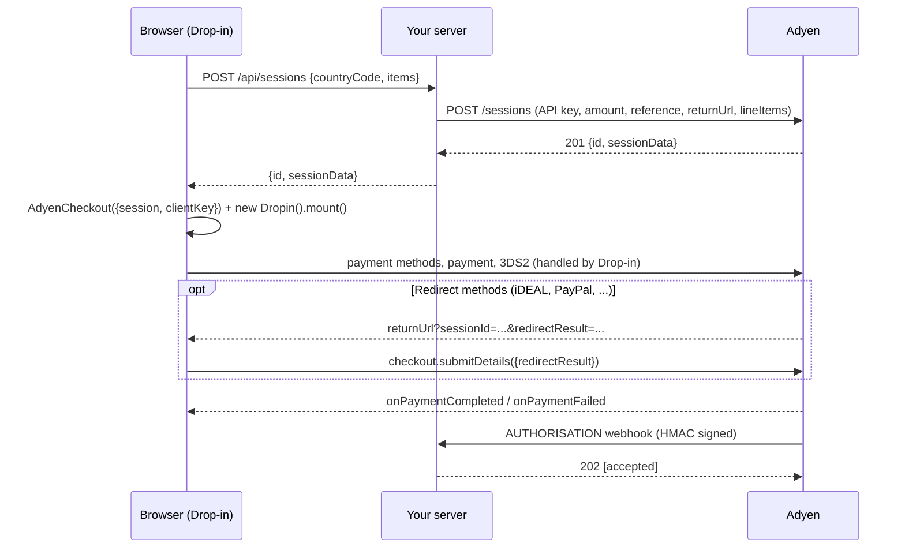

# Adyen Drop-in demo (Sessions flow)

A small Node.js + Express shop that takes payments with **Adyen Web Drop-in v6.45.2** using the
**Sessions flow**. It's modelled on Adyen's
[checkout-example](https://github.com/adyen-examples/adyen-node-online-payments/tree/main/checkout-example)
and follows the [Sessions flow docs](https://docs.adyen.com/online-payments/build-your-integration/sessions-flow?platform=Web&integration=Drop-in&version=6.45.2).

The checkout page has an **Integration inspector** that shows each step live: the `/sessions`
request and response, Drop-in events in the browser, and incoming webhooks. Use it to walk a
customer through what happens where during a technical call.

## Run it

```bash
npm install
cp .env.example .env    # then fill in your TEST credentials
npm start               # http://localhost:8080
```

| Variable | Where to find it |
| --- | --- |
| `ADYEN_API_KEY` | Customer Area → Developers → API credentials → your `ws_` user → API key |
| `ADYEN_CLIENT_KEY` | Same credential → Client settings → Client key. Add `http://localhost:8080` to **Allowed origins** |
| `ADYEN_MERCHANT_ACCOUNT` | Your merchant account name, e.g. `YourCompanyECOM` |
| `ADYEN_HMAC_KEY` | Developers → Webhooks → your Standard webhook → HMAC key (optional locally) |
| `BASE_URL` | Public URL when you're not on localhost (ngrok, Codespaces). Used for `returnUrl` |

> Never commit `.env`. It's in `.gitignore`. The API key stays on the server; only the client key reaches the browser.

### Webhooks (optional, recommended for the demo)

Adyen has to reach your server, so expose it publicly:

```bash
ngrok http 8080
```

In Customer Area → Developers → Webhooks, add a **Standard webhook**:
- URL: `https://<your-ngrok-host>/api/webhooks/notifications`
- Generate an HMAC key, put it in `.env` as `ADYEN_HMAC_KEY`, and restart.
- Set `BASE_URL=https://<your-ngrok-host>` too, so redirects come back through the same host.

The result page then shows the `AUTHORISATION` webhook arriving next to the client result.

## How it works



1. **One server call.** `POST /api/sessions` prices the cart on the server, then calls Adyen
   `/sessions` with `merchantAccount`, `amount`, `reference`, `returnUrl`, `countryCode`,
   `shopperLocale`, `lineItems` (needed for Klarna/Riverty) and an idempotency key.
2. **Drop-in does the rest.** The browser creates `AdyenCheckout` with `{ id, sessionData }`.
   Drop-in loads the payment methods for that country, currency and amount, collects card data in
   Adyen-hosted fields (PCI SAQ A), makes the payment and handles 3DS2 and redirects.
3. **Redirects.** Adyen sends the shopper back to `/redirect?...&sessionId=&redirectResult=`, which
   recreates `AdyenCheckout` with the session id and calls `checkout.submitDetails()`.
4. **Result.** `onPaymentCompleted` / `onPaymentFailed` drive the shopper UI. The result page also
   checks `GET /sessions/{id}?sessionResult=` from the server.
5. **Webhooks are the source of truth.** `/api/webhooks/notifications` verifies the HMAC
   signature, deduplicates retries, acknowledges with 2xx and updates the order.

### Things to try in the demo

- **Country selector**: switch NL → GB → US and watch the payment methods and currency change
  (iDEAL only shows for NL/EUR). This comes from your Customer Area configuration, not from code.
- **Drop-in options**: holder name, billing address and "open first method" are client-side config
  (`paymentMethodsConfiguration`).
- **Tokenise**: adds `shopperReference` + `storePaymentMethodMode: askForConsent` to the session.
  After one payment with "Save for my next payment" ticked, the card shows up as a stored method.
- **Refusal**: pay with holder name `DECLINED` or a wrong CVC.

### Test cards

| Card | Number | Expiry / CVC |
| --- | --- | --- |
| Visa (3DS2, password `password`) | 4917 6100 0000 0000 | 03/30 · 737 |
| Mastercard | 5555 3412 4444 1115 | 03/30 · 737 |
| Amex | 3700 0000 0000 002 | 03/30 · 7373 |

More in [Adyen's test card list](https://docs.adyen.com/development-resources/testing/test-card-numbers).

## Project layout

```
server.js                 Express app
src/config.js             env vars + validation
src/adyen.js              Adyen Node library client (Checkout API, HMAC validator)
src/catalog.js            products, countries/currencies, server-side order pricing
src/routes/payments.js    /api/config, /api/sessions, session result, orders, inspector events
src/routes/webhooks.js    /api/webhooks/notifications (HMAC, dedupe, order update)
src/orders.js             in-memory order store (use a database in production)
src/eventLog.js           in-memory event log streamed to the inspector (SSE)
public/                   store, checkout (Drop-in), redirect, result, how-it-works pages
```

## Going live checklist

- Switch `ADYEN_ENVIRONMENT=LIVE` and use your live
  [URL prefix](https://docs.adyen.com/development-resources/live-endpoints) and live CDN
  (`checkoutshopper-live.cdn.adyen.com`), and add the `integrity` hashes from the Adyen docs to the
  script and stylesheet tags.
- Persist orders and webhook events in a database; process webhooks asynchronously.
- Always verify the webhook HMAC, and fulfil orders on the webhook, not on the client result.
- Add your production domain to the client key's allowed origins.
