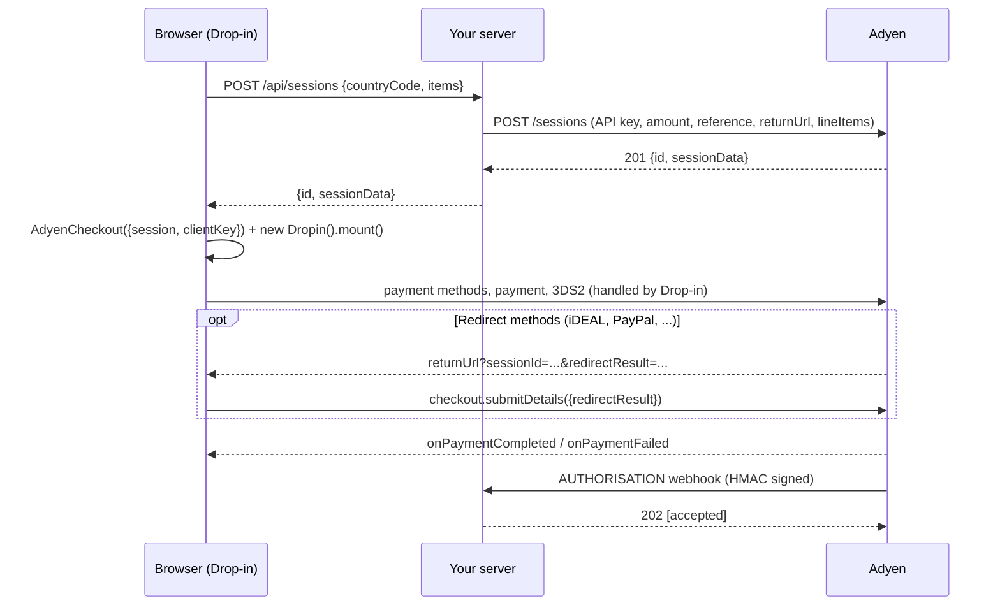

# Kestrel & Co. × Adyen: Drop-in demo and case study

Prepared for the Adyen Implementation Manager case study. It has two parts:

- **[Case study](docs/CASE_STUDY.md)** (also at `/case-study` in the app): a fictional Amsterdam e-commerce brand moving
  its web checkout to Adyen. It covers the merchant, pain points, goals, recommended integration, architecture, plan,
  test plan, go-live checklist and how to adapt when the conversation changes direction.
- **Working demo:** Kestrel & Co.'s checkout, a plain JavaScript + Node.js app.

A small Node.js + Express shop that takes payments with **Adyen Web Drop-in v6.45.2** using the
**Sessions flow**. It's modelled on Adyen's
[checkout-example](https://github.com/adyen-examples/adyen-node-online-payments/tree/main/checkout-example)
and follows the [Sessions flow docs](https://docs.adyen.com/online-payments/build-your-integration/sessions-flow?platform=Web&integration=Drop-in&version=6.45.2).

Inspired by Google's livestream
[Collect payments on the Web with Google Pay and Adyen](https://www.youtube.com/watch?v=7irwGKe4D_Q),
the checkout page lets you switch live between:

- **Backend flow:** Sessions (one `/sessions` call) or Advanced (`/paymentMethods`, `/payments`, `/payments/details`)
- **Frontend:** Drop-in (every method in one UI) or Components (an express Google Pay button above a Card form)
- **UI customisation:** Google Pay button type, colour, size and radius; asking for email, billing or shipping address in
  the Google Pay sheet; card holder name; billing address; tokenisation

The side panel has two tabs:
- **Inspector:** a live timeline of server calls, Adyen responses, browser events and webhooks.
- **Code:** the browser, server and webhook code that produces what's on screen. It updates as you change options.

## Run it

```bash
npm install
cp .env.example .env    # paste the TEST credentials from the case study PDF (apiKey, clientKey, merchant account)
npm start               # http://localhost:8080
```

When you paste the API key from the PDF:
- It's split over two lines. Join them into one line.
- Wrap it in single quotes, because it contains `$`, `(` and `,`.

```bash
ADYEN_API_KEY='AQE...=-...'
ADYEN_CLIENT_KEY=test_...
ADYEN_MERCHANT_ACCOUNT=AdyenAccount606ECOM
```

Invisible characters picked up when copying from a PDF are stripped automatically. Keep port **8080**: the client key
only works on origins allowed in the Customer Area, and `http://localhost:8080` is the usual one. If Drop-in shows an
origin error, the client key doesn't allow your URL.

Pages: `/` shop · `/checkout` · `/case-study` · `/how-it-works`

| Variable | Where to find it |
| --- | --- |
| `ADYEN_API_KEY` | Customer Area → Developers → API credentials → your `ws_` user → API key |
| `ADYEN_CLIENT_KEY` | Same credential → Client settings → Client key. Add `http://localhost:8080` to **Allowed origins** |
| `ADYEN_MERCHANT_ACCOUNT` | Your merchant account name, e.g. `YourCompanyECOM` |
| `ADYEN_HMAC_KEY` | Developers → Webhooks → your Standard webhook → HMAC key (optional locally) |
| `BASE_URL` | Public URL when you're not on localhost (ngrok, Codespaces). Used for `returnUrl` |

> Never commit `.env`. It's in `.gitignore`, and this repo is public. The API key stays on the server; only the client
> key reaches the browser.

### Google Pay

1. Customer Area → Settings → Payment methods → **Add payment method** → Google Pay (on the ECOM merchant account).
2. Open the checkout in **Chrome** on `localhost` or HTTPS. Google Pay needs a secure context.
3. In TEST, Google Pay returns test tokens: you can pick a real card from your Google account and nothing is charged.
   To see Google's test cards in the sheet, join the
   [Google Pay test card suite](https://developers.google.com/pay/api/web/guides/resources/test-card-suite) group.
4. Going live: get a Google `merchantId` from the Google Pay & Wallet Console, register your domain there, and add it to
   the Google Pay configuration in the Customer Area.

If Google Pay is missing from `/paymentMethods`, Components mode tells you so on the page.

### Webhooks (optional, recommended for the demo)

Adyen has to reach your server, so expose it publicly:

```bash
ngrok http 8080
```

In Customer Area → Developers → Webhooks, add a **Standard webhook**:
- URL: `https://<your-ngrok-host>/api/webhooks/notifications`
- Generate an HMAC key, put it in `.env` as `ADYEN_HMAC_KEY`, and restart.
- Set `BASE_URL=https://<your-ngrok-host>` too, so redirects come back through the same host.

The result page then shows the `AUTHORISATION` webhook arriving next to the client result.

## How it works



1. **One server call.** `POST /api/sessions` prices the cart on the server, then calls Adyen
   `/sessions` with `merchantAccount`, `amount`, `reference`, `returnUrl`, `countryCode`,
   `shopperLocale`, `lineItems` (needed for Klarna/Riverty) and an idempotency key.
2. **Drop-in does the rest.** The browser creates `AdyenCheckout` with `{ id, sessionData }`.
   Drop-in loads the payment methods for that country, currency and amount, collects card data in
   Adyen-hosted fields (PCI SAQ A), makes the payment and handles 3DS2 and redirects.
3. **Redirects.** Adyen sends the shopper back to `/redirect?...&sessionId=&redirectResult=`, which
   recreates `AdyenCheckout` with the session id and calls `checkout.submitDetails()`.
4. **Result.** `onPaymentCompleted` / `onPaymentFailed` drive the shopper UI. The result page also
   checks `GET /sessions/{id}?sessionResult=` from the server.
5. **Webhooks are the source of truth.** `/api/webhooks/notifications` verifies the HMAC
   signature, deduplicates retries, acknowledges with 2xx and updates the order.

### Suggested run-of-show (30-minute call)

1. **Context (3 min).** Open `/case-study`: who Kestrel & Co. are, what's hurting, the goals (§1–3). Agree the agenda.
2. **The shopper view (3 min).** Cart → checkout → pay with a 3DS2 test card in Drop-in. Show the result page and the
   webhook arriving.
3. **Sessions flow (6 min).** Open the **Code** tab: one server call, `{ id, sessionData }` to the browser, Drop-in does
   the rest. Walk the Inspector timeline top to bottom. Tie it back to the recommendation (§4.1) and architecture (§4.3).
4. **Google Pay and UI (6 min).** Pay with Google Pay inside Drop-in. Switch to **Components** to show an express
   checkout button above the card form. Change button type, colour and radius, and turn on email or shipping address.
   The Code tab follows every change. Mention `onAuthorized` for validating the address before the payment.
5. **Advanced flow (6 min).** Flip to **Advanced**: three endpoints, `onSubmit` / `onAdditionalDetails`, and the
   `/payments` request with `browserInfo`, `origin` and `nativeThreeDS`. Use the "If the conversation changes direction"
   table (§8) to discuss when you'd switch.
6. **Production readiness (6 min).** Webhooks plus HMAC, idempotency, never trusting the client amount, capture at
   shipment, tokenisation, test plan and go-live checklist (§4.4, §6, §7). Close with the discovery questions (§9).

### Things to try in the demo

- **Country selector**: switch NL → GB → US and watch the payment methods and currency change
  (iDEAL only shows for NL/EUR). This comes from your Customer Area configuration, not from code.
- **Drop-in options**: holder name, billing address and "open first method" are client-side config
  (`paymentMethodsConfiguration`).
- **Tokenise**: adds `shopperReference` + `storePaymentMethodMode: askForConsent` to the session.
  After one payment with "Save for my next payment" ticked, the card shows up as a stored method.
- **Refusal**: pay with holder name `DECLINED` or a wrong CVC.

### Test cards

| Card | Number | Expiry / CVC |
| --- | --- | --- |
| Visa (3DS2, password `password`) | 4917 6100 0000 0000 | 03/30 · 737 |
| Mastercard | 5555 3412 4444 1115 | 03/30 · 737 |
| Amex | 3700 0000 0000 002 | 03/30 · 7373 |

More in [Adyen's test card list](https://docs.adyen.com/development-resources/testing/test-card-numbers).

## Project layout

```
server.js                 Express app
src/config.js             env vars + validation
src/adyen.js              Adyen Node library client (Checkout API, HMAC validator)
src/catalog.js            products, countries/currencies, server-side order pricing
src/routes/payments.js    /api/config, /api/sessions, session result, orders, inspector events
src/routes/advanced.js    Advanced flow: /api/advanced/paymentMethods, /payments, /payments/details
src/routes/caseStudy.js   renders docs/CASE_STUDY.md at /case-study (mermaid diagrams)
docs/CASE_STUDY.md        the Kestrel & Co. case study
src/routes/webhooks.js    /api/webhooks/notifications (HMAC, dedupe, order update)
src/orders.js             in-memory order store (use a database in production)
src/eventLog.js           in-memory event log streamed to the inspector (SSE)
public/                   store, checkout, redirect, result, how-it-works pages
public/js/checkout.js     Adyen Web setup for both flows, Drop-in and Components (Google Pay + Card)
public/js/snippets.js     generates the Code tab from the current options
```

## Going live checklist

- Switch `ADYEN_ENVIRONMENT=LIVE` and use your live
  [URL prefix](https://docs.adyen.com/development-resources/live-endpoints) and live CDN
  (`checkoutshopper-live.cdn.adyen.com`), and add the `integrity` hashes from the Adyen docs to the
  script and stylesheet tags.
- Persist orders and webhook events in a database; process webhooks asynchronously.
- Always verify the webhook HMAC, and fulfil orders on the webhook, not on the client result.
- Add your production domain to the client key's allowed origins.
