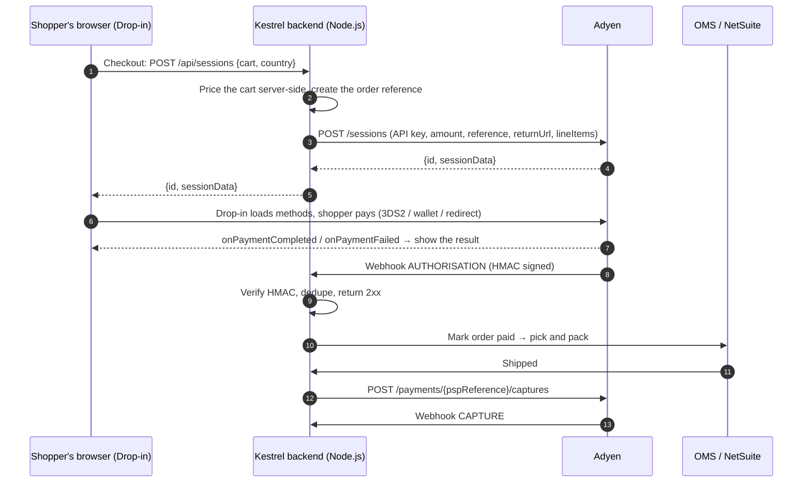

# Case study: Kestrel & Co. moves its web checkout to Adyen Drop-in

> **Fictional merchant, prepared for a mock technical call.**
> Role: Adyen Implementation Manager. Audience: Kestrel & Co.'s Head of E-commerce, Lead Developer and Payments/Finance lead.
> Every number in this document is illustrative.

## 1. The merchant

| Area | Details |
| --- | --- |
| **Company** | Kestrel & Co., a direct-to-consumer brand for premium sunglasses and audio accessories, based in Amsterdam |
| **Online revenue** | ~€38M per year, average order value ~€95, about 400k orders per year |
| **Channels** | Web shop (85% of revenue, 64% of traffic on mobile). iOS and Android apps are planned for next year |
| **Markets** | Netherlands, Belgium, Germany, France, United Kingdom, Sweden, Poland. US and Australia next year |
| **Tech stack** | Custom headless storefront: Node.js (Express) backend, plain JavaScript frontend, hosted on AWS, in-house order management system (OMS), NetSuite for finance |
| **Team** | 6 developers, 1 QA engineer, a product owner for checkout, and a finance controller who owns reconciliation |
| **Today** | A legacy gateway with a redirect-based hosted payment page, plus separate PayPal and Klarna contracts and a different acquirer for the UK |

## 2. What's hurting today

1. **Shoppers drop off at the payment step.** About 18% of shoppers who reach payment leave, mostly on mobile during the redirect to the hosted page.
2. **Local methods are missing.** There's no iDEAL in the Netherlands, no Bancontact in Belgium, no BLIK in Poland and no Swish in Sweden: the methods most shoppers there actually use.
3. **No wallets.** With 64% of traffic on mobile, the lack of Apple Pay and Google Pay means card details get typed on a phone keyboard.
4. **Authorisation rate of about 86% on cards.** Since PSD2, 3DS2 challenges and false fraud declines block good customers.
5. **Returning customers retype their card** on every order.
6. **Finance spends about 3 days a month** reconciling settlements from three providers in three report formats.

## 3. Goals and success metrics

| Goal | Metric | Target |
| --- | --- | --- |
| Make paying easier | Payment step conversion | +5 percentage points |
| Approve more good payments | Card authorisation rate | at least 90% |
| Pay the way locals pay | Share of local methods and wallets | at least 40% of transactions in NL, BE, PL and SE |
| Faster repeat purchases | Returning customers paying with a stored card | at least 30% |
| One view of the money | Month-end reconciliation | under 1 day |
| Hit the deadline | Live in every market | 2 weeks before the peak-season code freeze |

## 4. Recommended solution

### 4.1 Integration choice: Web Drop-in with the Sessions flow

| Option | What it is | Fit for Kestrel & Co. |
| --- | --- | --- |
| Pay by Link / Hosted Checkout | Adyen-hosted page | ✗ Keeps the redirect they want to get rid of |
| **Drop-in + Sessions flow** | One server call (`/sessions`); the pre-built UI renders every enabled method and handles 3DS2, redirects and wallets | **✓ Recommended for the launch.** Fastest to build for a 6-developer team, payment stays on their own page, PCI scope stays at SAQ A |
| Drop-in + Advanced flow | Three server calls (`/paymentMethods`, `/payments`, `/payments/details`) | Use it if they need their own logic between payment steps (see §8) |
| Components | Individual UI building blocks, e.g. a standalone Google Pay button | ✓ Phase 2: an express Google Pay / Apple Pay button on the cart and product pages |
| API only | Their own UI, raw card data | ✗ PCI scope moves to SAQ D. Not needed |

**Why Sessions first:** one endpoint to build and secure. Adyen keeps the payment state, runs 3DS2 natively, and Drop-in automatically shows the right methods for each shopper's country, currency and amount. The same `/sessions` endpoint also serves iOS and Android Drop-in later.

### 4.2 Payment methods per market

| Market | Currency | Launch methods |
| --- | --- | --- |
| Netherlands | EUR | Cards, **iDEAL**, Apple Pay, Google Pay, Klarna, PayPal |
| Belgium | EUR | Cards, **Bancontact** (card and mobile), Apple Pay, Google Pay, Klarna |
| Germany | EUR | Cards, **Klarna**, PayPal, Apple Pay, Google Pay |
| France | EUR | Cards incl. **Cartes Bancaires**, Apple Pay, Google Pay, PayPal |
| United Kingdom | GBP | Cards, Apple Pay, Google Pay, Klarna, PayPal |
| Sweden | SEK | Cards, **Swish**, Klarna, Apple Pay, Google Pay |
| Poland | PLN | Cards, **BLIK**, Przelewy24, Google Pay |

The frontend needs no code per method. Methods are switched on in the Customer Area, and Drop-in picks them up from the session's `countryCode`, `amount.currency` and `shopperLocale`. Klarna needs `lineItems`, which the server always sends.

### 4.3 Architecture

**Responsibilities**

- **Browser:** shows Drop-in using the **client key**, which is safe to expose. Card data is encrypted in Adyen-hosted fields and never touches Kestrel's servers.
- **Backend:** holds the **API key**, sets the amount (never trusting the browser), creates sessions, receives webhooks and triggers captures and refunds.
- **Webhooks are the source of truth.** The browser result drives the shopper's screen; only the `AUTHORISATION` webhook releases the order.

### 4.4 Key design decisions

| Topic | Recommendation | Why |
| --- | --- | --- |
| Capture | **Manual capture at shipment**, triggered by the OMS | Physical goods: charge when the goods ship. Fewer refunds for cancelled orders |
| Tokenisation | `shopperReference` + `storePaymentMethodMode: askForConsent`, `recurringProcessingModel: CardOnFile` | One-click checkout for returning customers, with their consent |
| 3DS2 | Native 3DS2 (in-page), leave Dynamic 3DS rules on | Fewer redirects; challenges only when the issuer or risk rules ask |
| Risk | Start on default RevenueProtect rules, review after 2 weeks of live data | Avoid over-blocking during launch |
| Idempotency | `Idempotency-Key` on every `/sessions` and `/payments` call | Safe retries on network timeouts without double charges |
| Webhooks | Verify HMAC, store the raw event, process asynchronously, dedupe on `pspReference + eventCode` | Adyen retries until it gets a 2xx, so duplicates are normal |
| Reconciliation | Settlement details report into NetSuite, matched on `merchantReference` | One report format for every method and market |

## 5. Implementation plan (6 weeks)

| Week | Focus | Deliverables |
| --- | --- | --- |
| 1 | Kick-off and design | Test account, API credential, client key with allowed origins, webhook endpoint and HMAC key, data mapping (order → `reference`) |
| 2 | Core build | `POST /api/sessions`, Drop-in on the checkout page, `returnUrl` page, webhook handler with HMAC and dedupe |
| 3 | Methods and wallets | Local methods per market, Apple Pay domain verification, Google Pay, tokenisation |
| 4 | Back office | Capture on shipment and refunds from the OMS, reconciliation report into NetSuite, risk rules review |
| 5 | Testing and UAT | Test matrix below, webhook retries and duplicates, peak-load test of the session endpoint |
| 6 | Go-live | Live account and credentials, live endpoints, rollout NL → BE/DE → rest behind a feature flag, then hypercare |

## 6. Test plan

| Scenario | How to test | Expected result |
| --- | --- | --- |
| Card, frictionless | Mastercard 5555 3412 4444 1115, 03/30, 737 | `Authorised` + `AUTHORISATION` webhook |
| Card, 3DS2 challenge | Visa 4917 6100 0000 0000, password `password` | Challenge in the page, then `Authorised` |
| Refusal | Holder name `DECLINED` or a wrong CVC | `Refused`, shopper can retry |
| Redirect method | iDEAL with country NL, pick the outcome in the simulator | Back on `returnUrl` → `submitDetails` → result |
| Wallet | Google Pay in Chrome (TEST tokens) | `Authorised` |
| Tokenisation | Tick "save", pay, start a new session with the same `shopperReference` | Stored card shown |
| Webhook security | Send a webhook with a wrong HMAC | Rejected (401), order untouched |
| Duplicate webhook | Replay the same webhook | Processed once |
| Amount tampering | Change the amount in the browser request | Server ignores it; Adyen charges the server price |

## 7. Go-live checklist

- [ ] Live merchant account approved (KYC) and the payment methods enabled per market
- [ ] Live API credential with only the roles it needs; API key stored in a secrets manager
- [ ] Live endpoint URL prefix configured; `environment: "live"` and the live CDN for Adyen Web
- [ ] Live client key, with the production domains as allowed origins
- [ ] Webhooks configured in live with a new HMAC key, and the endpoint monitored
- [ ] Apple Pay domain verified in live; Google Pay `merchantId` from the Google Pay & Wallet Console
- [ ] Capture and refund flows tested end-to-end from the OMS
- [ ] Dashboards for authorisation rate, conversion and webhook failures; alerting on errors
- [ ] Rollback plan: feature flag back to the old checkout

## 8. If the conversation changes direction

How I'd adapt if the customer brings up something new during the call:

| They say… | My recommendation |
| --- | --- |
| "Shipping costs change on the payment page, so the amount isn't final when the page loads." | Create the session once the amount is final, or use the **Advanced flow**, where the amount is set in `/payments` at submit time. |
| "Our fraud team wants to run its own checks before every payment." | **Advanced flow**: `onSubmit` sends `state.data` to their backend, which runs the check and then calls `/payments`. Adyen's risk engine still runs too. |
| "Our designers want the wallet buttons on the product page." | **Components**: a standalone `GooglePay` / `ApplePay` component used as an express checkout, alongside Drop-in at checkout. |
| "We're moving to Salesforce Commerce Cloud / Shopify next year." | Use Adyen's plugin for that platform. The Drop-in experience and Customer Area setup carry over. |
| "We're launching mobile apps." | iOS and Android Drop-in reuse the same `/sessions` endpoint and webhooks; only the client changes. |
| "Finance needs daily numbers." | Settlement details and payment accounting reports, downloadable automatically, plus report webhooks when they're ready. |
| "Black Friday traffic scares us." | Idempotency keys, async webhook processing, a timeout and retry policy, a code freeze, and a phased rollout behind a feature flag. |

## 9. Questions for discovery

1. Which markets and currencies go live first, and is the peak-season deadline fixed?
2. Is the amount final when the checkout page loads, or do shipping, discounts or gift cards change it?
3. Capture straight away or at shipment? Do you ship partial orders (partial captures)?
4. Who owns refunds and chargebacks: OMS, customer service tool or Customer Area?
5. Do you need stored cards, subscriptions, or both?
6. How will your servers receive webhooks (public endpoint, queue, WAF rules)?
7. Which reports does finance need, and in which format for NetSuite?
8. Any plans for in-store payments (unified commerce) or marketplaces?

## 10. The demo

The working demo in this repository is Kestrel & Co.'s checkout:

- **Shop → Checkout**: Drop-in on the Sessions flow, with the **Inspector** showing every request, browser event and webhook live.
- **Integration path** switch: Sessions ↔ Advanced and Drop-in ↔ Components (express Google Pay + Card), to make §4.1 and §8 concrete.
- **Customise the UI**: Google Pay button and sheet options, card fields, tokenisation, with the **Code** tab showing the exact config.
- **Result page**: the browser result, the server-side session result and the webhook, side by side.
